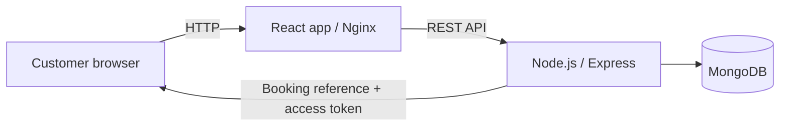

# Homaid


> A home-services booking application built with React, Node.js, MongoDB and Docker.

Homaid lets customers browse service categories and submit a booking request with a preferred time and service address. It is the application project in my portfolio; the infrastructure scope is intentionally limited to the technologies listed in the project stack.

## Features

- Browse the service catalogue and see indicative prices.
- Submit a booking request with customer details, address and requested time.
- Retrieve a booking using its reference and private access token.
- Track the booking through a controlled status lifecycle.
- Persist service bookings in MongoDB.
- Run the frontend, API and database together with Docker Compose.

## Architecture



The browser loads the React app from Nginx. Nginx forwards `/api` requests to the Express service. The API validates incoming booking data and stores the booking in MongoDB. A booking token is returned once at creation; only its hash is stored by the API.

## Repository layout

```text
.
├── api/
│   ├── src/
│   │   ├── domain.js
│   │   └── server.js
│   ├── test/
│   └── Dockerfile
├── web/
│   ├── src/
│   └── Dockerfile
├── docs/
│   ├── architecture.md
│   ├── api.md
│   ├── security.md
│   └── runbook.md
├── .github/workflows/ci.yml
└── docker-compose.yml
```

## Run locally

Requirements: Docker Engine and Docker Compose.

1. Copy `.env.example` to `.env`.
2. Set `ADMIN_API_TOKEN` to a long, unique random value.
3. Start the stack:

   ```bash
   docker compose up --build
   ```

4. Open [http://localhost:8080](http://localhost:8080).

The API health endpoint is available through the web proxy at `/api/health`; readiness is available at `/api/ready`.

For API development without Compose:

```bash
cd api
npm install
npm test
npm run check
```

Set `MONGODB_URI`, `MONGODB_DB`, `PORT`, `WEB_ORIGIN` and `ADMIN_API_TOKEN` before starting the API.

## API overview

| Method | Route | Purpose |
|---|---|---|
| GET | `/api/services` | List service categories |
| GET | `/api/services/:id` | Get one service |
| POST | `/api/bookings` | Create a booking request |
| GET | `/api/bookings/:id` | Retrieve a booking with its access token |
| PATCH | `/api/bookings/:id/status` | Update status using the operator token |

The detailed request and response contract is in [docs/api.md](docs/api.md). For a complete booking walkthrough, see [docs/local-testing.md](docs/local-testing.md).

## CI

GitHub Actions runs the API tests and syntax checks, builds the React frontend, and builds both Docker images for pushes and pull requests to `main`.

## Security notes

The API applies request validation, security headers, an explicit CORS allowlist and rate limiting. Booking lookup requires the private token returned at creation. The static operator token is a small-project mechanism, not a substitute for a provider/admin identity system.

Before using this as a public service, add customer and provider authentication, role-based authorization, managed MongoDB with private networking and backups, HTTPS, central logging/metrics, dependency and image scanning, and load/security testing. See [docs/security.md](docs/security.md).

## Project scope

This repository covers the Homaid project described in my resume: React.js, Node.js REST APIs, MongoDB, Docker and Git. It does not claim a deployed cloud environment, integrated payments, verified providers or a live marketplace.
