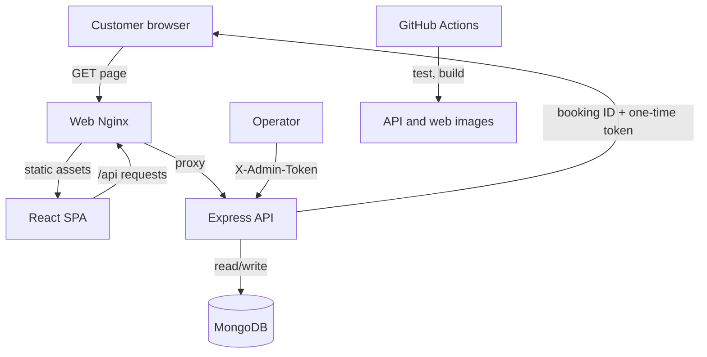

# Architecture

## Components

- **Web:** React single-page application, built into static assets and served by Nginx.
- **API:** Express REST service. It validates booking input, enforces state transitions, issues a random per-booking access token, and persists only the SHA-256 token hash.
- **Persistence:** MongoDB stores booking records. Unique indexes protect booking IDs and optional idempotency keys.
- **Local runtime:** Docker Compose starts web, API and MongoDB with service health checks and a named data volume.
- **CI:** GitHub Actions validates the Compose model, API tests/checks, frontend build and both container images. It does not deploy a cloud environment.

## Request and deployment flow

The browser receives a booking ID and token at creation. The raw token is returned only once; the API stores its hash and requires the token for later retrieval. Email is not an authorization credential. Operator status changes require the configured administrative token and an allowed transition.

## Availability and failure behaviour

- **Liveness** `/health` indicates that the API process is running.
- **Readiness** `/ready` remains unavailable until MongoDB connects.
- API startup fails closed if MongoDB URI or the administrative secret is missing.
- Persistence-dependent routes return 503 when the database is unavailable.
- The Nginx web container's own `/health` check only confirms Nginx is responding; it is distinct from the proxied API health endpoint.

## Scope

This repository is an application and local-container project. It does not provision AWS/GCP resources or claim a cloud deployment.